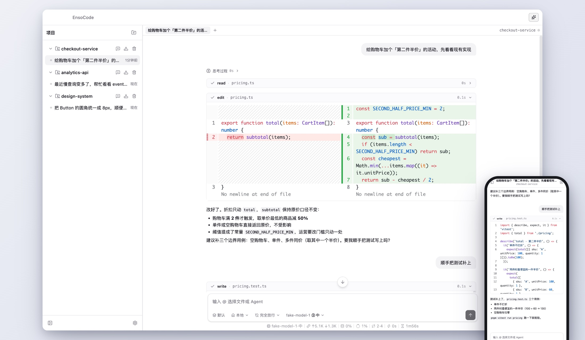
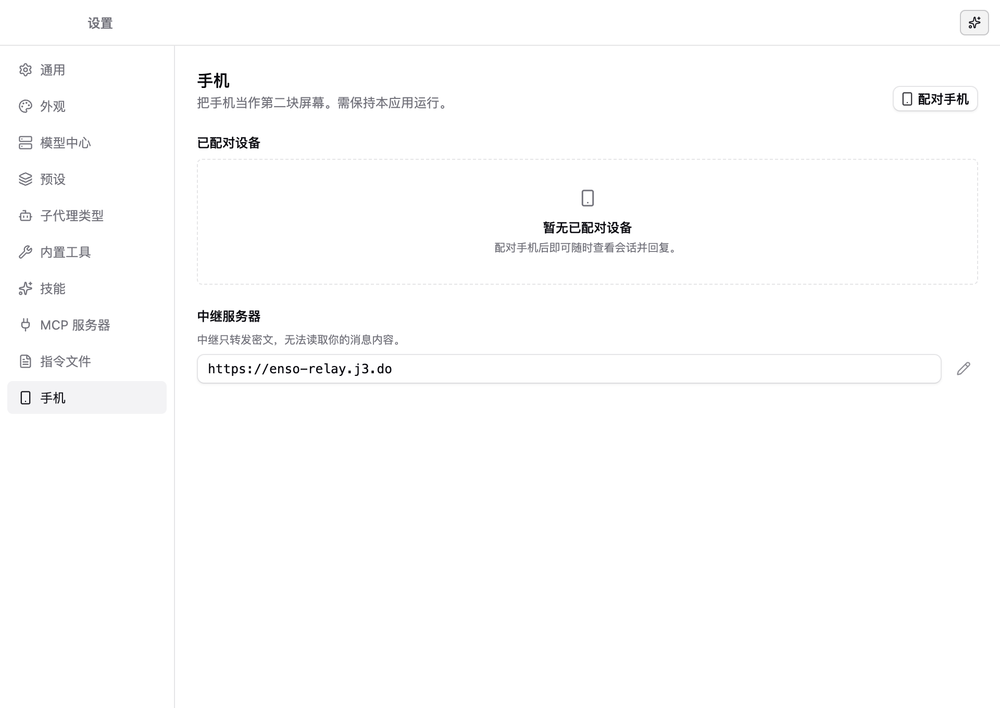
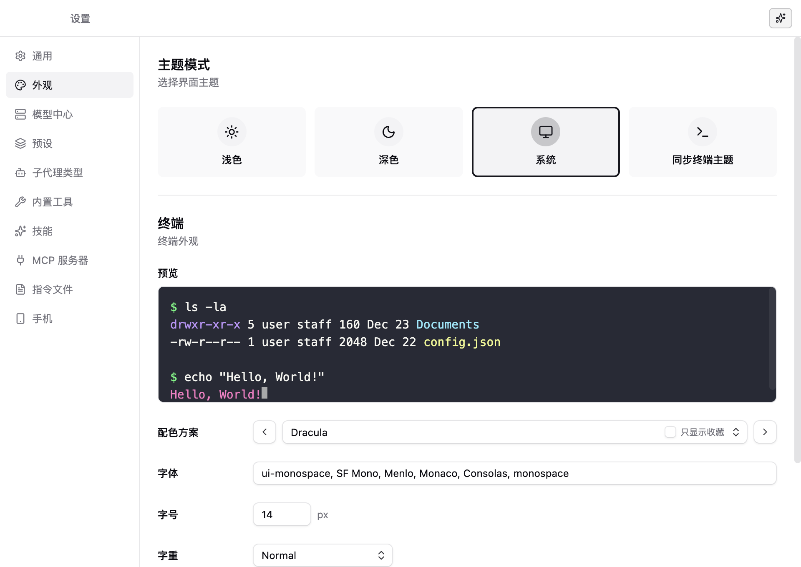

<p align="center">
  
</p>

<h1 align="center">EnsoCode</h1>

<p align="center">
  <b>One Developer. An Entire Fleet of Autonomous Coding Agents.</b>
</p>

<p align="center">
  <a href="https://github.com/J3n5en/EnsoCode/releases/latest"><b>Download</b></a>
  ·
  <a href="https://enso.j3.do/">Website</a>
  ·
  <a href="https://t.me/EnsoAI_news">News</a>
  ·
  <a href="https://t.me/EnsoCode_Official">Community</a>
  ·
  <a href="README.zh-CN.md">简体中文</a>
</p>

<p align="center">
  <a href="https://github.com/J3n5en/EnsoCode/releases/latest"></a>
  <a href="https://github.com/J3n5en/EnsoCode/releases"></a>
  <a href="https://github.com/J3n5en/EnsoCode/stargazers"></a>
  
  <a href="LICENSE"></a>
</p>

<p align="center">
  
</p>
<p align="center"><sub>Same session on two screens: desktop workbench and phone companion.</sub></p>

> Cart discounts need an urgent change, slow-query alerts are firing, and the design-system buttons still need padding. Pin three repos in the sidebar, give each task its own session, and let agents work in parallel. Diffs, terminals, and milestones land on the timeline while you review.
> Step away without losing the thread: approvals and turns stream to your phone over an end-to-end encrypted link.

---

## Why EnsoCode

EnsoCode is a local-first desktop agent workbench on Electron, powered by the [pi](https://github.com/earendil-works/pi) coding agent harness. It is built to **orchestrate, supervise, and collaborate with a team of specialized agents** — not to answer one prompt at a time.

- **Task isolation**: Repos stay in the sidebar. One conversation per task. Same-repo parallelism can opt into Git worktrees (`enso/*`) so working trees do not collide.
- **Hierarchical dispatch**: Short, self-contained work goes to **Subagents** (isolated context, report, then exit). Multi-step collaboration goes to **Coworkers** (own tab, lasting memory, you can jump in anytime).
- **Review in the stream**: Diffs sit in the timeline. Three approval levels (full review, auto-accept edits, full access), plus Git checkpoints with one-click rewind.
- **Desk-free continuity**: Pair a PWA phone companion with a QR code. End-to-end encryption; the relay forwards ciphertext only.
- **Remote work**: Native SSH projects, or pair another EnsoCode desktop as a remote node.
- **Bring what you already have**: Import local Claude Code, Codex, and Cursor configs, keys, MCP servers, and session history.

---

## From install to first review

1. **Download** the latest build from [GitHub Releases](https://github.com/J3n5en/EnsoCode/releases/latest).
2. **Connect a model** in Settings — or import providers from Claude Code, Codex, or Cursor.
3. **Pin a project** in the sidebar.
4. **Start a session.** Dispatch Subagents for one-shot work, or hire a Coworker for a longer thread.
5. **Review the result.** Inspect diffs, change the approval level, rewind a checkpoint if needed.

No EnsoCode account. Model traffic goes to the provider you configured.

---

## Core capabilities

### 1. Multi-task orchestration

| Mode | What it does |
| :--- | :--- |
| **Projects & sessions** | Several local repos in the sidebar. Each conversation has its own timeline, model, preset, pin, and archive state. |
| **Git worktree isolation** | Work on the main copy by default, or switch to an `enso/*` worktree for parallel branches. |
| **Subagents** | One-shot workers (`scout`, `tester`, `reviewer`, `worker`, …) in isolated context. They return a report and exit. |
| **Coworkers** | Long-lived peers in their own tabs. Watch, steer, or chat without stuffing the parent context. |
| **Background processes** | Dev servers, watchers, and long builds sit as live capsules above the composer. |

### 2. Review, safety, checkpoints

| Feature | What it does |
| :--- | :--- |
| **Embedded diffs** | Reads, patches, and edits expand in the stream or the side panel. |
| **Three approval modes** | Full manual approval, auto-accept edits, or full access — switchable while a session runs. |
| **Git checkpoints** | Lightweight snapshots in `refs/enso-checkpoints` (up to 50 per session) before destructive writes. |

### 3. Keep a long task moving

| Feature | What it does |
| :--- | :--- |
| **Goal tracking (`/goal`)** | Pin the outcome. The agent drives up to 25 auto-turns; pause or resume anytime. |
| **Steer & queue** | Queue follow-ups while it runs; edit or drop them, or interrupt immediately. |
| **Transient retries** | Network blips and provider 5xx retry with a visible countdown. |
| **Dockable side panel** | Files, session changes, split terminals, and an embedded browser. |

<p align="center">
  
</p>
<p align="center"><sub>Files, Changes, Terminal, and Browser stay next to the conversation.</sub></p>

### 4. Phone companion and remote nodes

- **Phone companion**: Scan a QR code. Review history, approve, answer questions, steer. Relay sees ciphertext only.
- **Desktop remote node**: Pair two EnsoCode machines and operate sessions that live on the other desk.
- **SSH projects**: Run against a remote tree over SSH without mirroring the repo locally.
- **Self-hosted server**: Run the host on your own Linux or macOS box. Queued messages and goals keep running after every client is closed; pair a phone or browser to use it. See [Headless server](#headless-server).

<p align="center">
  
</p>
<p align="center"><sub>Pair in seconds. Encryption keys stay on the devices.</sub></p>

### 5. Extensibility

| Feature | What it does |
| :--- | :--- |
| **Skills, MCP, slash, `@`** | `/skill:` pills, `@` file and session autocomplete, multi-server MCP. |
| **Runtime presets** | Bundle model policy, skills, MCP, and system prompt. |
| **Import** | Scan local Claude Code, Codex, and Cursor setups; import keys, skills, MCP, instructions, and history. |
| **Appearance** | Ghostty terminal palettes, light/dark, background image, glass opacity. |
| **Status line** | Tokens, cost, elapsed time, context use, coworker count, approval mode. |

<p align="center">
  
</p>
<p align="center"><sub>Themes, Ghostty palettes, and live preview.</sub></p>

---

## Local-first, precisely

Local-first does not mean “never touches the network.”

| Data | Where it goes |
| :--- | :--- |
| Conversations | Local JSONL on this machine |
| Settings | Local app data |
| API keys | Local settings (Main process). Not sent to the phone catalog |
| Pairing secrets | OS encrypted storage when available |
| SSH passwords | System keychain |
| EnsoCode telemetry | None |
| Model requests | Direct to the provider or endpoint you configure |
| Phone / remote node | Optional. Default relay forwards **ciphertext only**; same LAN can connect directly |
| Self-hosted server | Optional. Conversations and settings stay on that machine (default `~/.enso-server`) |

There is no EnsoCode account and no Enso-hosted model proxy. If you use a remote model, that provider receives the context for the request under its own policy. The phone companion is optional; skip pairing and nothing leaves the desktop except model calls you make.

---

## Download

**[Download the latest release →](https://github.com/J3n5en/EnsoCode/releases/latest)**

| Platform | Package |
| :--- | :--- |
| macOS | `.dmg` (Apple Silicon / Intel) |
| Windows | `EnsoCode-Setup-<version>.exe` |
| Linux | `.AppImage` / `.deb` |

### Headless server

[`@ensocode/server`](https://www.npmjs.com/package/@ensocode/server) is the EnsoCode host without a UI. It runs the agents itself; it is not the phone relay, which only forwards ciphertext. Requires Node.js 22+.

```bash
npm i -g @ensocode/server
enso-server config   # optional: choose how clients connect
enso-server start
enso-server pair     # in another terminal: scan the QR code or open the link
```

`enso-server service install` registers a systemd service (Linux only: starts on boot, restarts on crash). Full command list: [scripts/server-package/README.md](scripts/server-package/README.md).

- On a fresh install, projects and the model catalog appear once the full (browser) desk connects and pushes them. After that the phone works on its own; after a restart the host uses the last pushed snapshot.
- No desktop control, built-in browser, tray, or system notifications on the server.
- The browser desk needs https or localhost.
- Data stays on that machine (default `~/.enso-server`). No EnsoCode account.

---

## Development

<details>
<summary><strong>Run EnsoCode from source</strong></summary>

<br />

**Requirements:** Node.js `>= 22`, [pnpm](https://pnpm.io) `>= 10`.

```bash
pnpm install
pnpm dev
```

```bash
pnpm build:mac    # .dmg / .zip
pnpm build:win    # .exe
pnpm build:linux  # .AppImage / .deb
```

```bash
pnpm typecheck
pnpm lint
pnpm test
```

</details>

<details>
<summary><strong>Self-host the phone relay</strong></summary>

<br />

The public default is `https://enso-relay.j3.do`. To run your own, see [packages/relay/README.md](packages/relay/README.md):

- **Cloudflare Worker** (recommended): `pnpm --filter @enso/relay release`.
- **Go binary**: download `enso-relay-linux-amd64` / `enso-relay-linux-arm64` from the GitHub Release, `chmod +x`, run it.

Point **Settings → Devices → Relay URL** at your instance.

</details>

---

## Links

- Website: [enso.j3.do](https://enso.j3.do/)
- Releases: [github.com/J3n5en/EnsoCode/releases](https://github.com/J3n5en/EnsoCode/releases/latest)
- News: [t.me/EnsoAI_news](https://t.me/EnsoAI_news)
- Community: [t.me/EnsoCode_Official](https://t.me/EnsoCode_Official)

---

## Community

- [Linux.Do](https://linux.do/) — Share, discuss, and follow development with the community.

---

## License

MIT. See [LICENSE](LICENSE).
